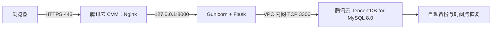

# 腾讯云部署

腾讯云 MySQL 8.0 免费试用实例已申请成功，试用到期时间为 2026-12-10 13:54（北京时间）。本文说明 CVM 私网部署；本次 10 天免费展示采用 [Render + 腾讯云](render.md)。数据库导入与云端连通状态以实际部署记录为准。

## 架构



腾讯云 CVM 与云数据库 MySQL 选择同地域、同 VPC，以数据库详情页的内网地址连接。这与腾讯云[内网连接官方说明](https://cloud.tencent.com/document/product/236/102005)一致。应用服务器负责登录、校验、业务事务与模板渲染；MySQL 负责持久化、连接查询、锁、约束、视图及备份。

## 实例参数

在用户自己的云控制台完成申请时，记录下列参数。项目不会购买资源。

| 项目 | 配置 |
| --- | --- |
| 数据库产品 | 云数据库 MySQL（TencentDB for MySQL） |
| 引擎 | MySQL 8.0，建议当前可用的 8.0 补丁版本 |
| 字符集 | utf8mb4 |
| 存储引擎 | InnoDB |
| 数据库名 | northwind |
| 网络 | 与应用 CVM 同地域、同 VPC |
| 数据库端口 | 实例详情显示的端口，通常 3306 |
| 应用账号 | northwind_app，仅本库所需权限 |
| 维护账号 | 用于首次导入、扩展和恢复；与运行账号分开 |
| CVM 系统 | Ubuntu 22.04/24.04 或其他支持 Python 3.11+ 的 Linux |
| 应用入口 | Nginx HTTPS，Gunicorn 仅监听回环地址 |

控制台界面和可用规格以实际账号为准。申请完成后需要内网地址、端口、数据库名，以及应用服务器的连接方式；密码直接填写服务器 `.env`，避免发到报告、截图或代码库。

## 网络与账号

1. 数据库安全组仅放行应用 CVM 的私网来源地址及数据库端口。
2. CVM 入站为 HTTPS 443，SSH 22 仅向用户自己的管理来源地址开放。HTTP 80 可用于跳转或证书验证。
3. Gunicorn 绑定 `127.0.0.1:8000`，无需开放 5000/8000 端口。
4. MySQL 账号 host 与实际 CVM 私网来源一致；若通过控制台创建 host 为 `%`，仍用安全组限定来源。
5. 数据库维护账号保留 DDL 权限，应用账号授予 `SELECT, INSERT, UPDATE, DELETE, SHOW VIEW`，限定 `northwind.*`。

由具备账号管理权限的维护账号创建应用账号。将地址、密码替换为实际值：

```sql
CREATE DATABASE northwind CHARACTER SET utf8mb4 COLLATE utf8mb4_0900_ai_ci;
CREATE USER 'northwind_app'@'10.0.1.10' IDENTIFIED BY 'REPLACE_WITH_RANDOM_PASSWORD';
GRANT SELECT, INSERT, UPDATE, DELETE, SHOW VIEW ON northwind.* TO 'northwind_app'@'10.0.1.10';
```

腾讯云托管账号的可授予权限遵循控制台规则。无需 SUPER、FILE、存储过程或 EVENT 权限；扩展脚本使用预处理语句创建必要索引。视图使用 SQL SECURITY INVOKER。

## 本机先连接云数据库

如果 Flask 暂时仍运行在本机，可通过已授权的 CVM SSH 隧道访问云数据库私网地址：

```bash
ssh -N -L 127.0.0.1:3308:数据库内网地址:3306 \
  -o ServerAliveInterval=30 -o ExitOnForwardFailure=yes ubuntu@CVM公网地址
```

对应 `.env` 设置 `DB_HOST=127.0.0.1`、`DB_PORT=3308`。SSH 隧道保持开启，数据库看到的连接来源为 CVM。数据库使用证书主机名校验时，需按其证书域名安排本机解析与隧道地址，不要关闭证书校验来绕过错误。SSH 隧道本身对本机到 CVM 的链路进行加密。

只有云数据库、没有 CVM 时，可按腾讯云[外网连接说明](https://cloud.tencent.cn/document/product/236/102006)做开发期连接，严格限制客户端公网来源并启用证书校验。正式部署优先采用私网。

## 导入与配置

在 CVM 上传整个项目源码和本地静态资源，排除 `.env`、`.venv`、`instance`、`backups`。为目标服务器重新安装 Python 依赖。下例在 `/opt/northwind-management` 部署：

```bash
cd /opt/northwind-management
python3 -m venv .venv
source .venv/bin/activate
python -m pip install -r requirements.txt
cp .env.example .env
chmod 600 .env
```

生成随机 `SECRET_KEY`，填写：

```dotenv
APP_ENV=production
SECRET_KEY=服务器专用的随机值，至少32位
DB_HOST=数据库实际内网地址
DB_PORT=3306
DB_NAME=northwind
DB_USER=northwind_app
DB_PASSWORD=应用账号密码
DB_SSL_CA=/opt/northwind-management/certs/数据库CA证书.pem
SESSION_COOKIE_SECURE=true
```

`DB_SSL_CA` 为可选项。数据库启用 SSL 后下载腾讯云提供的 CA 并设置该路径，PyMySQL 同时开启证书与主机名校验。只有在 HTTPS 入口已配置好时启用 `SESSION_COOKIE_SECURE=true`，否则浏览器在 HTTP 下不会发送会话 cookie。

先在 CVM 使用维护账号导入一次；脚本根据 `.env` 的地址连接，`--user` 只覆盖账号并交互读取密码：

```bash
python scripts/init_db.py --user 维护账号
python scripts/init_admin.py --username admin
```

如果云库已经有 Northwind 历史数据，核对数据版本，只执行 `python scripts/init_db.py --extensions-only --user 维护账号`。修改环境变量、启动和重启应用都不会重导数据。

新环境迁移原始样例时可导入附带 SQL；已有新增业务数据时，从源实例一致性备份并恢复，包含 `admin_user` 与 `app_order_meta`，随后按目标权限重建视图、更新管理员凭据与 `SECRET_KEY`。

## 应用服务

创建专用 Linux 用户 `northwind`，赋予项目读取权限及 `.env` 的适当归属。证书由 Nginx 管理，勿将数据库或云账号密码写进 systemd 文件。

```bash
sudo useradd --system --home /opt/northwind-management --shell /usr/sbin/nologin northwind
sudo chown -R northwind:northwind /opt/northwind-management
sudo cp deployment/northwind.service /etc/systemd/system/northwind.service
sudo systemctl daemon-reload
sudo systemctl enable --now northwind
sudo systemctl status northwind
```

若专用用户已存在，跳过创建用户。`deployment/nginx.conf` 提供内网 HTTP 调试配置；正式环境使用 `deployment/nginx-https.conf`，替换域名和证书路径，已包含 443 监听与 80 到 HTTPS 的跳转。按系统约定启用该配置后：

```bash
sudo nginx -t
sudo systemctl reload nginx
curl -f http://127.0.0.1:8000/health
sudo journalctl -u northwind -n 50 --no-pager
```

使用真实域名访问登录页，验证商品列表、历史订单、报表，再进行一笔系统订单的创建与取消核对。ICP备案等域名接入要求以实际服务地域与腾讯云规定为准。

## 备份与维护

在云控制台设置自动备份周期、保留期限并检查成功状态。变更结构前额外备份；恢复优先到新实例或独立库，核对订单数、明细数、状态、库存和销售总额后再切换应用配置。腾讯云控制台的按时间点恢复能力和保留窗口以实例可用选项为准。

应用附带 `scripts/backup_db.py` 支持逻辑备份，可作导出与课程演示。监控 MySQL 连接数、慢查询、CPU、存储、行锁等待；事务死锁或连接短时故障会回滚并显示操作未完成，管理员可检查库存和订单列表后重新操作。

## 等价平台

原需求中的阿里云 ECS + RDS MySQL、华为云 ECS + RDS for MySQL 可使用相同应用。选 MySQL 8.0、同地域同 VPC、内网连接和最小权限账号，导入同一 SQL，更改 `.env`。控制台路径、安全组、白名单及备份入口依据各平台官方文档操作，业务代码和表结构保持一套。

## 接入清单

- 数据库和 CVM 地域、VPC、地址、端口已确认。
- CVM 到数据库连接成功，应用账号权限已核对。
- 数据已导入，扩展 SQL 和视图已验证。
- `.env` 和管理员已为服务器重新配置。
- HTTPS、服务自启动、数据库备份已验证。
- 云端实际测试结果与截图补入报告。
