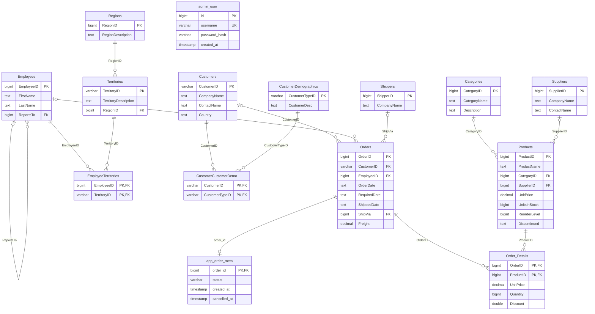

# 实体关系

以下 Mermaid 源码可直接编辑。Order_Details 对应实际含空格表名 `Order Details`。图中展示各实体的标识与关键关联字段；完整字段见数据字典。

# 关系模式

核心关系为 Customers(CustomerID)、Orders(OrderID, CustomerID, EmployeeID, ShipVia)、Order Details(OrderID, ProductID)、Products(ProductID, CategoryID, SupplierID)、Categories(CategoryID)、Suppliers(SupplierID)、Employees(EmployeeID, ReportsTo)、Shippers(ShipperID)。

订单明细由 (OrderID, ProductID) 唯一标识；一笔订单中同一商品只出现一次。员工与地区、客户与客户类型通过复合主键的中间表实现多对多关系。可空外键允许原始数据中的未指定关联，前端新建订单要求明确选择客户、员工、物流公司。

`admin_user` 是独立管理员实体。`app_order_meta` 与 Orders 为零或一对一关系：无扩展记录表示原始历史订单；有记录表示本系统订单，通过 active/cancelled 管理取消状态。
