# 基于 Flask 与 MySQL 的商品销售及订单管理系统设计与实现

课程：数据库原理与技术  
姓名、学号、班级：提交前填写  
实现与本地验证日期：2026-11-10  
技术栈：Python、Flask、PyMySQL、Jinja2、MySQL 8.0、Bootstrap 5、Apache ECharts

## 第一章 系统概述

### 1.1 背景

商品销售业务同时涉及客户、商品、供应商、订单与库存。若使用分散表格记录，一次下单需要在多个文件间同步价格、数量和库存，易出现重复编号、关联缺失与库存不一致。本项目将这些业务组织为关系数据库，以 Web 管理界面完成操作，并通过数据库约束、事务和锁维护数据一致性。

课程设计围绕数据库全流程展开：从需求确定实体与关系，保留 Northwind 真实关系模式，建立必要扩展、视图和索引，再将 SQL 查询及事务嵌入 Flask 应用。最终形成可运行的本地系统，以及后续腾讯云数据库接入方案。

### 1.2 目标

系统为管理员提供统一的商品、客户、订单和基础资料管理入口；在多商品下单时原子地创建订单、保存成交明细并扣减库存；取消本系统订单时恢复库存并调整有效销售统计。数据库设计同时展示主外键、复合主键、数据完整性、连接查询、分组统计、子查询、视图、索引与备份恢复。

### 1.3 数据集

使用 [DemoDB 发布的 Northwind MySQL 文件](https://northwind.demodb.dev/downloads/)。原始文件于 2026-11-10 下载，630,119 字节，SHA-256 为 `56b9178a14240ed71e06268652cc566caa16e7c06c46360b892a034d0a0e38a9`。原文件保留 MIT 许可及 JP White 上游归属声明，完整文件与说明位于 `data/`。

导入后，13 张原始业务表包含 3,310 条记录：77 件商品、93 位客户、830 笔订单、2,155 条订单明细，另有分类、供应商、员工、物流、地区及关联表。实际订单日期为 2016-07-04 至 2018-05-06。仪表盘默认覆盖全量日期，避免以当前年份筛选导致历史业务统计为空。

原始库存作为开发初始库存快照，系统不根据历史订单再次扣减库存。新增业务只影响之后创建的系统订单。全部界面数据来自本地 MySQL，Bootstrap、ECharts 与业务脚本均保存在项目中，初始化完成后的运行不依赖外部接口。

## 第二章 需求分析

### 2.1 用户与功能

系统角色为管理员。管理员登录后维护商品与客户，查询和创建订单，管理基础资料，查看经营统计。所有写入通过带 CSRF token 的 POST 表单提交，未登录用户访问业务页面会跳转到登录页。

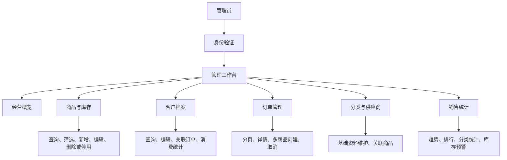

商品列表提供名称搜索、分类和供应商筛选、库存状态。客户列表提供名称和国家查询，并汇总有效订单与累计消费。订单列表支持编号、客户、日期、状态筛选及分页，详情区分商品金额、运费与合计。分类和供应商可维护并查看关联商品，已有引用时阻止删除。

### 2.2 业务流程

以客户 ALFKI 购买 2 件 Chai 为例，商品当前价格为 18.00，折扣率为 0.1，则商品金额为 32.40；若运费为 8.50，订单合计为 40.90。业务确认时，系统锁定商品行、检查库存，再在同一事务内完成主表、明细、库存和状态写入。取消后，库存恢复 2 件，32.40 不再计入有效销售额。

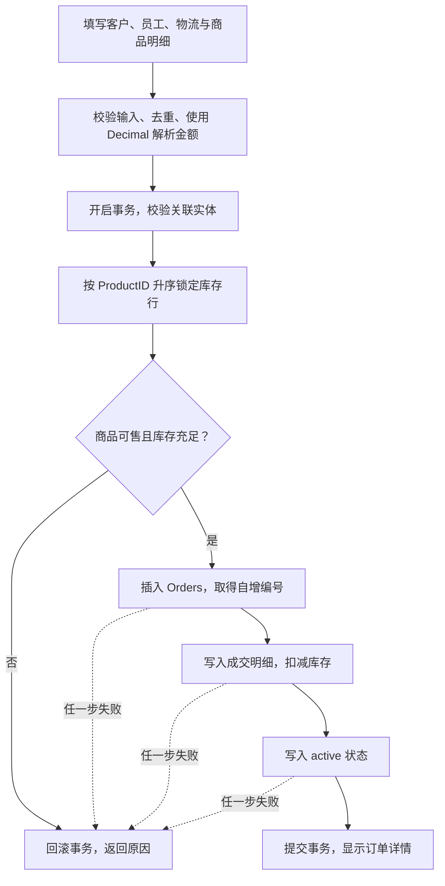

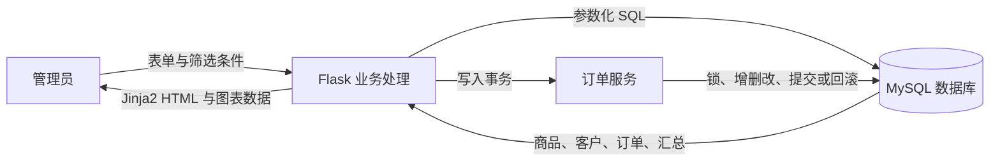

### 2.3 非功能需求

系统使用 MySQL 8.0、InnoDB 与 utf8mb4，维持已有主键和外键。金额使用 Decimal 解析和数据库 DECIMAL 计算。数据库连接按请求创建并在请求结束关闭；错误不暴露密码及完整数据库错误。界面采用中文、深蓝导航、浅色背景、白色卡片和统一表单，提供分页、空状态、验证提示、删除及取消确认。

## 第三章 数据库设计

### 3.1 概念设计

Customers、Employees、Shippers 分别与 Orders 构成一对多关系；Orders 与 Products 通过订单明细关联；Categories、Suppliers 分别与 Products 构成一对多关系。员工上下级通过 ReportsTo 自引用。地区与员工、客户类型与客户分别通过关联表表达多对多关系。

完整可编辑 E-R 图见 [ER图.md](ER图.md)。核心关系如下：

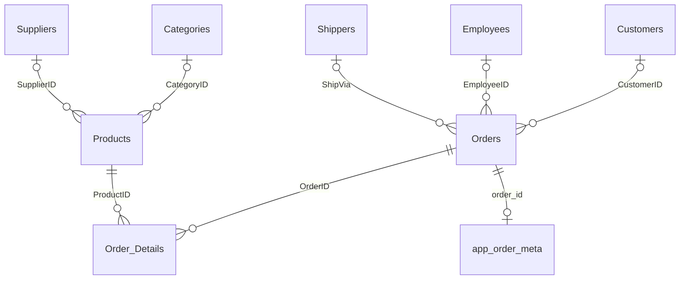

### 3.2 逻辑设计

保留原始关系模式，核心关系为：

- Customers(CustomerID, CompanyName, ContactName, …)。
- Orders(OrderID, CustomerID, EmployeeID, OrderDate, ShipVia, Freight, …)。
- Order Details(OrderID, ProductID, UnitPrice, Quantity, Discount)。
- Products(ProductID, ProductName, CategoryID, SupplierID, UnitPrice, UnitsInStock, …)。
- Categories(CategoryID, CategoryName, …)、Suppliers(SupplierID, CompanyName, …)。
- Employees(EmployeeID, ReportsTo, …)、Shippers(ShipperID, CompanyName, …)。

Order Details 的复合主键为 (OrderID, ProductID)，可防止同一订单重复记录同一商品；应用层也在获取锁前检查重复，给出明确输入错误。该表名含空格，所有 SQL 均使用反引号。

新增 `admin_user(id, username, password_hash, created_at)`，其中 username 唯一。新增 `app_order_meta(order_id, status, created_at, cancelled_at)`，order_id 同时为主键和 Orders 外键。status 限定 active/cancelled，并约束取消时间与状态一致。原始历史订单不创建扩展状态，缺少元数据即表示历史只读订单。

整数主键沿用源表 AUTO_INCREMENT，保留历史编号并由数据库处理并发生成。原始订单最大编号为 11077，首次新订单从 11078 起。客户由系统随机分配五字符字母数字编号，数据库主键约束负责最终唯一性。回滚可能产生自增编号间隙，订单业务不依赖编号连续。

### 3.3 数据字典

字段以实际下载的 MySQL SQL 为准，完整列、可空性、默认值、主外键、检查约束和索引见 [数据字典.md](数据字典.md)。该文档通过 `scripts/export_schema.py` 从 information_schema 导出。

| 字段 | 实际类型 | 业务含义 |
| --- | --- | --- |
| Products.ProductID | BIGINT AUTO_INCREMENT | 商品编号 |
| Products.ProductName | TEXT NOT NULL | 商品名称 |
| Products.UnitPrice | DECIMAL(5,2) | 商品当前目录价格 |
| Products.UnitsInStock | BIGINT | 当前库存 |
| Products.Discontinued | TEXT | 文本 0 为在售，1 为停用 |
| Orders.OrderID | BIGINT AUTO_INCREMENT | 订单编号 |
| Orders.OrderDate | TEXT | 原始 ISO 日期字符串 |
| Orders.CustomerID | VARCHAR(255) | 客户外键 |
| Orders.Freight | DECIMAL(6,2) | 运费 |
| Order Details.UnitPrice | DECIMAL(5,2) | 下单时成交单价 |
| Order Details.Discount | DOUBLE | 折扣率，0 至 1 |

原始折扣字段保留 DOUBLE。应用限制新增折扣最多六位小数；金额查询使用 `CAST(Discount AS DECIMAL(10,6))` 转为十进制计算，避免二进制小数误差传播到金额。商品金额保留计算精度，展示时统一格式化两位小数。

### 3.4 完整性与物理设计

所有表使用 InnoDB、utf8mb4。原有主外键继续限制悬空引用，商品价格与库存非负，明细数量必须大于零，折扣必须位于 0 至 1。应用校验名称非空、编号有效、价格和库存范围，并依据实际 DECIMAL 容量限制商品价格不超过 999.99、运费不超过 9999.99。

扩展脚本创建 Orders.OrderDate 的前 10 字符索引、Products.ProductName 的前 120 字符索引；Orders.CustomerID、Products.CategoryID 已有等效外键索引时复用。由于原始列是 TEXT，前缀索引满足索引长度要求并保持原字段结构。

### 3.5 视图

`v_order_amounts` 将订单与明细左连接，按订单汇总成交金额，并排除 app_order_meta.status 为 cancelled 的订单；运费保留为独立字段。无明细订单金额用 COALESCE 转为 0。

`v_product_sales` 从商品左连接明细，保留没有销量的商品，对取消订单明细贡献计为 0，汇总有效数量与金额。两视图都使用 SQL SECURITY INVOKER，运行账号凭自身权限访问底层表。原始快照两视图销售总额均为 1,265,793.0395。

## 第四章 架构与服务器

### 4.1 三层架构

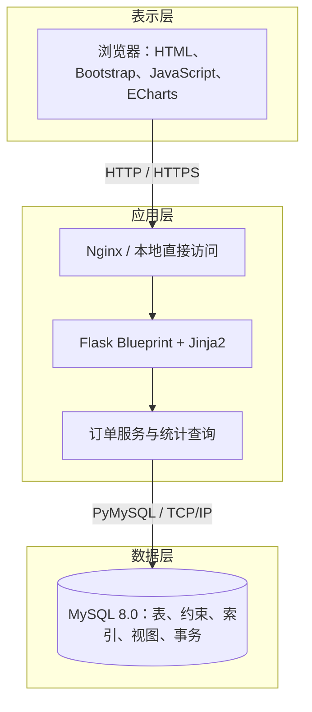

浏览器负责表单、交互和图表展示，应用层处理身份、验证、业务规则和页面渲染，数据库层负责持久化与一致性。这种 B/S 结构使用户通过浏览器使用系统，也使部署迁移集中在服务器和配置层面完成。

Flask 按 auth、dashboard、products、customers、orders、suppliers、reports 拆分 Blueprint，订单事务封装于 `app/services/order_service.py`。数据库访问统一使用 PyMySQL DictCursor，视图和聚合查询在 MySQL 端完成。

### 4.2 本地与云端

本地 Flask 监听 127.0.0.1:5000。常规本地 MySQL 可监听 3306；本次电脑已有 MySQL 8.4，因此另用 Docker 隔离运行 MySQL 8.0.46，端口仅绑定 127.0.0.1:3307，数据持久化在独立卷。此安排保证实际验证使用指定 8.0 系列，同时保留原有数据库服务。

腾讯云方案为 CVM 运行 Nginx、Gunicorn 和 Flask，云数据库 TencentDB for MySQL 8.0 独立保存数据。两者同地域、同 VPC，通过内网地址和 TCP 数据库端口连接。阿里云 ECS + RDS 与华为云 ECS + RDS 可使用相同业务代码和配置机制。

托管数据库的备份、存储、监控由云平台提供管理入口，本地数据库由开发者维护进程和数据文件；表结构、SQL 与事务语义保持 MySQL 一致。当前腾讯云资源正在申请，本报告只记录本地已验证事实，云端验收项单列于测试文档。

### 4.3 连接与安全

`.env` 保存 DB_HOST、DB_PORT、DB_NAME、DB_USER、DB_PASSWORD 和 SECRET_KEY，源码不包含数据库密码。连接在实际查询时创建，并通过 Flask teardown 关闭。会话配置 HttpOnly、SameSite=Lax，生产 HTTPS 环境启用 Secure；默认业务日期和数据库会话采用北京时间。

密码采用 Werkzeug 哈希，写操作统一校验 CSRF，SQL 使用参数绑定，动态表名和列名只来自代码内固定映射。删除与取消由 POST 提交，模板自动转义用户输入，并设置 CSP、禁止 iframe 嵌入等响应头。数据库访问异常返回简明提示，日志仅记录必要错误码。

云端运行账号仅授予本库 SELECT、INSERT、UPDATE、DELETE、SHOW VIEW；维护账号执行建表、索引、视图和恢复。数据库安全组仅放行应用服务器来源，公网入口为 Nginx HTTPS，Gunicorn 只监听回环地址。部署文件和具体执行步骤见 `deployment/`。

## 第五章 功能实现

### 5.1 登录与概览

页面结合湘潭大学校徽与藏青工作台风格，统一标题、表格、按钮及表单层级。校徽来自用户提供的原始 PNG，保留原色和透明度；登录页、侧栏和手机端工具栏共用同一本地素材。手机端采用可折叠导航和单列表单，仪表盘指标在窄屏下重排。

登录查询 admin_user 并验证密码哈希。验证成功后清理旧会话再设置用户编号和用户名，避免沿用旧登录状态。退出清理会话。初始化脚本交互读取密码并限制长度，重置已有账号需要显式 `--reset`。

仪表盘显示商品、客户、有效订单和累计销售额，数据源是实时 MySQL 查询。月度趋势按 LEFT(OrderDate,7) 分组，分类统计连接分类、商品、明细、订单与状态，近期订单按订单编号降序展示。当前库存达到阈值的在售商品在侧栏提示。历史样例的金额未强行标注为人民币，运费也未混入商品销售额。

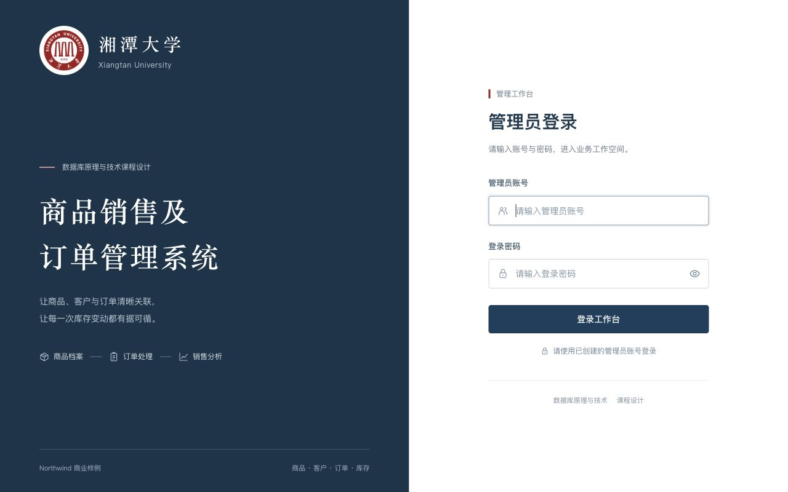

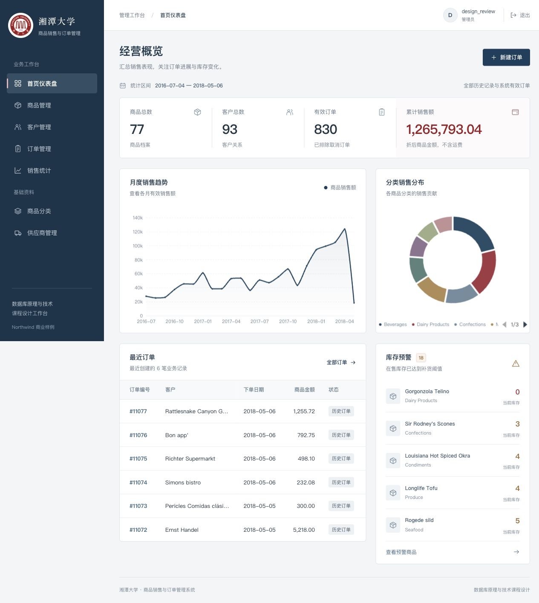

### 5.2 商品与客户

商品列表采用 JOIN 获取分类和供应商名称，通过参数化 WHERE 处理筛选，COUNT 与 LIMIT/OFFSET 完成分页。名称搜索将用户输入中的 LIKE 通配符转为字面字符，避免意外扩大匹配范围。新增和编辑验证引用实体存在，删除先检查订单明细，有引用则停用，未被使用的商品允许物理删除。

商品编辑隐藏保存表单打开时的库存值，提交时锁定商品并比较原库存。若期间已有销售更新库存，则拒绝使用旧表单覆盖，管理员重新打开后再编辑。这项检查与订单行锁配合，避免手工维护抹掉已发生的库存扣减。

客户列表按公司、联系人及国家查询，累计消费和有效订单基于 v_order_amounts。客户详情展示包括取消订单在内的订单记录，取消金额明确不计入累计消费。已有订单或客户类型关联的客户不能删除。

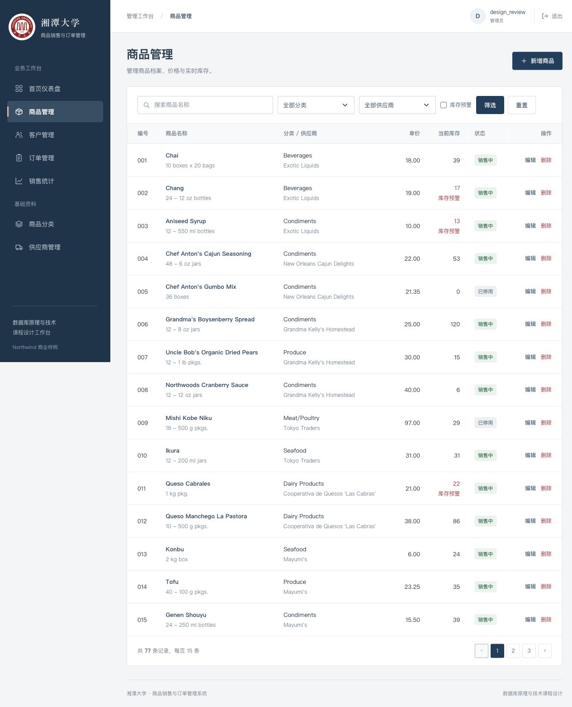

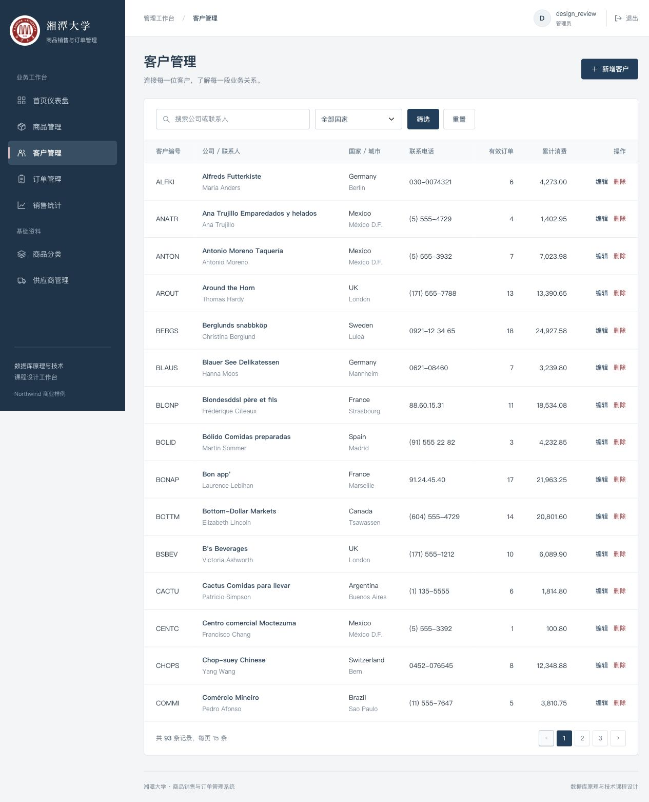

### 5.3 订单与库存

订单详情连接客户、员工和物流，明细连接商品名称，使用明细保存的 UnitPrice 计算金额。此后修改商品目录价格不会改变原订单成交金额。运费和商品金额分开列示，再计算含运费合计。

创建订单时首先解析和验证明细，拒绝同一商品重复出现。事务内校验客户、员工、物流并取得共享锁；再按 ProductID 升序逐行 SELECT FOR UPDATE，使用锁定后读取的实际库存和单价。所有商品通过后才插入订单、成交明细，扣减库存并写入 active 元数据。任一步失败由事务上下文 rollback，成功后 commit。

取消时首先锁定 Orders 与 app_order_meta，确认该订单由系统创建且仍为 active。随后按商品编号顺序锁定相关库存，逐项恢复数量，更新 cancelled 和取消时间，再提交。第二个并发取消请求会等待第一个释放订单锁，读到已取消状态后拒绝，库存只恢复一次。

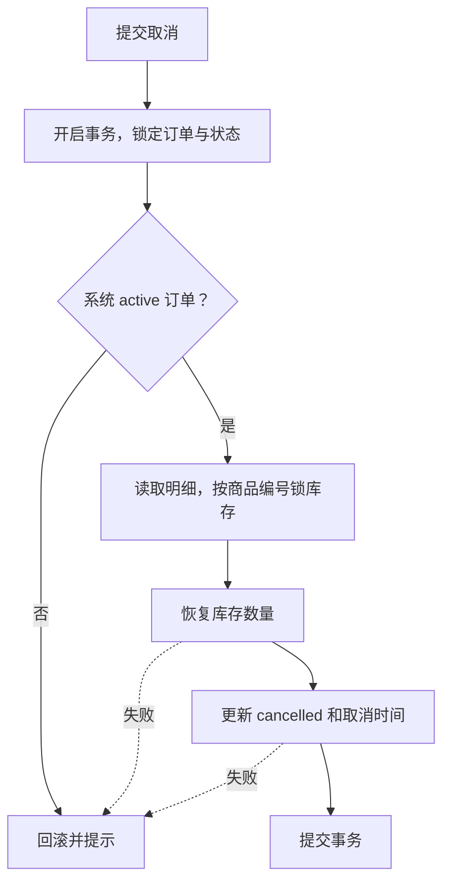

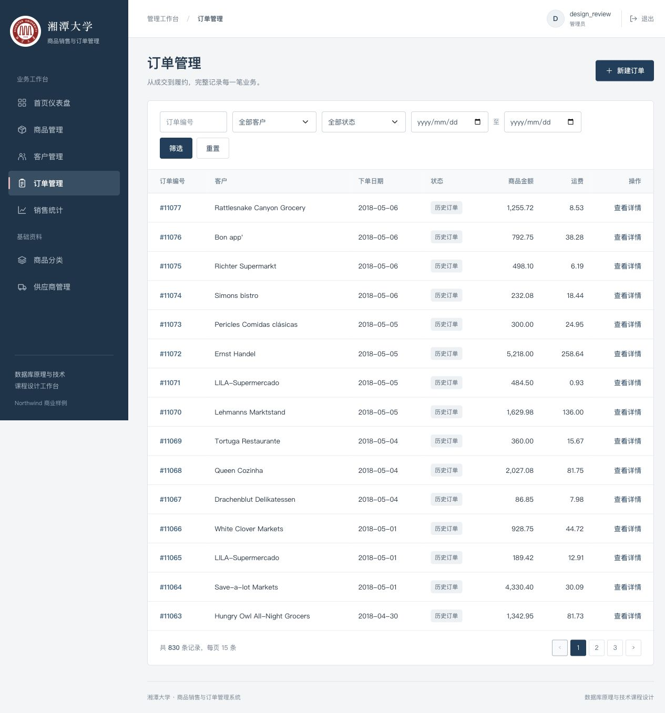

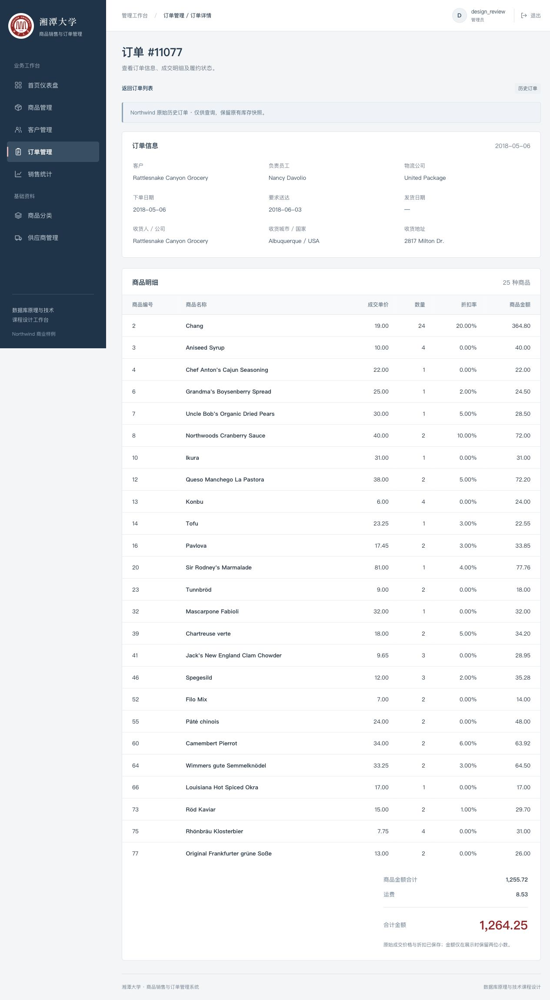

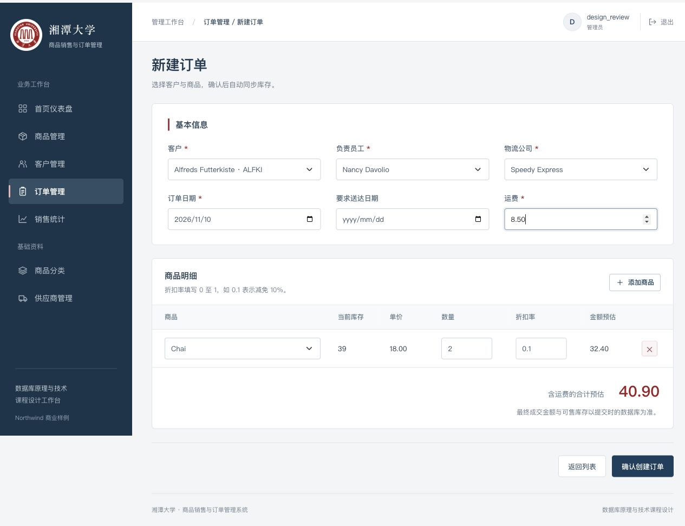

### 5.4 基础资料与报表

分类与供应商通过固定配置复用列表、表单及删除保护流程，表名和字段来自白名单。关联商品数使用子查询计算，点击后跳转到对应商品筛选。分类或供应商被商品引用时不能删除，外键进一步保护并发情况下的引用完整性。

销售统计支持订单日期范围，结束日期转为次日的排他上界，避免遗漏结束日数据。图表包含月度趋势、分类分布、商品销售额和销量排行；表格提供分类、商品、客户和月度明细，库存预警使用当前库存并明确不受日期筛选影响。ECharts 从服务器渲染的 JSON 读取真实 SQL 结果。

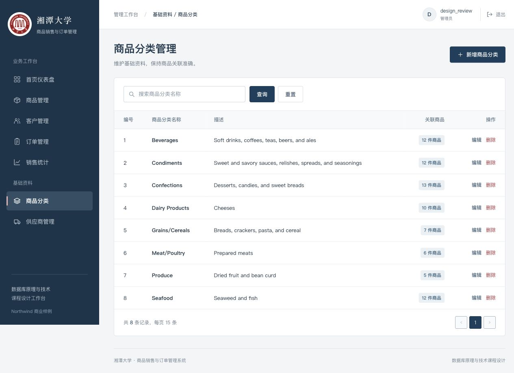

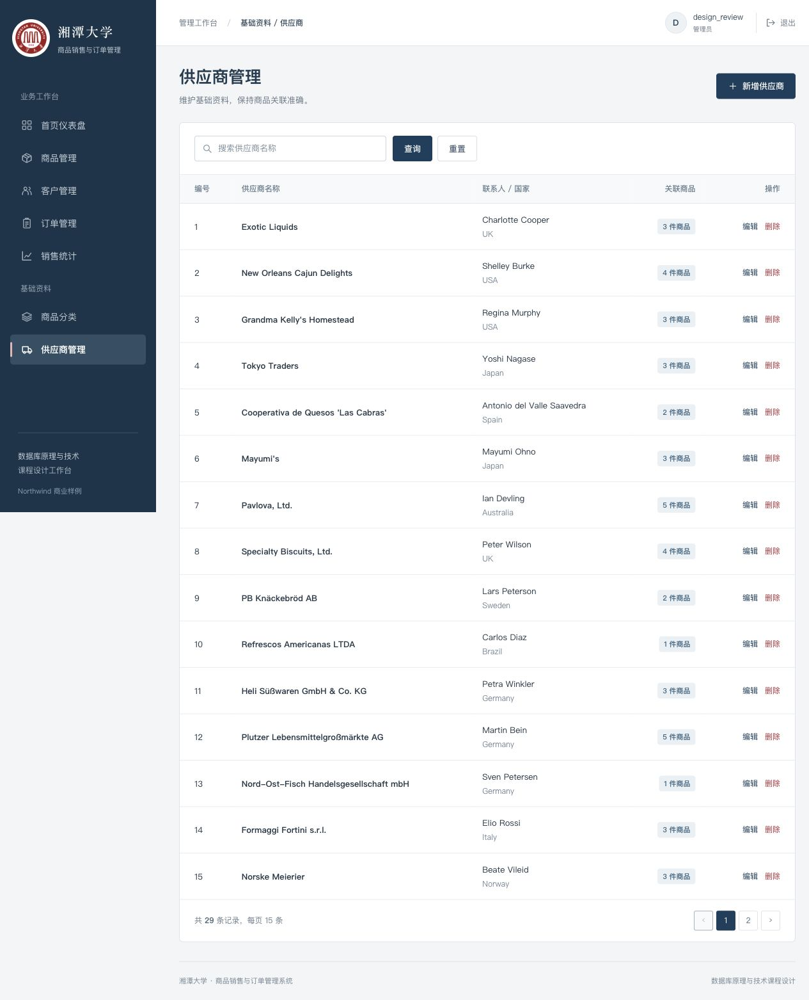

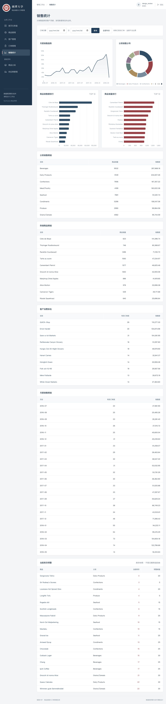

## 第六章 系统测试

### 6.1 方法

测试在 MySQL 8.0.46 中为本次运行创建随机后缀临时库，导入与开发库相同的原始数据和扩展。Flask test client 验证请求、会话、CSRF、模板和 CRUD；订单事务使用实际独立数据库连接验证锁与回滚。结束后删除专用测试库，开发库历史数据保持原样。

执行 `RUN_MYSQL_TESTS=1 .venv/bin/python -m pytest -q --junitxml=docs/test-results.xml`，31 项测试通过（26 项 MySQL 核心测试、2 项公开页面测试与 3 项加密配置测试）。逐项记录见 [测试用例.md](测试用例.md)，机器可读记录见 `test-results.xml`。

### 6.2 关键结果

多商品下单示例购买 Chai 2 件、折扣 0.1，并购买 Chang 3 件、不折扣。商品合计为 18 × 2 × 0.9 + 19 × 3 = 89.40；库存分别由 39、17 变为 37、14。取消后恢复为 39、17，两个视图中的有效销售额恢复为下单前值，第二次取消被拒绝。

库存不足、重复商品、停用商品、不存在商品、数量为零、折扣越界及 NaN 输入均被拒绝，未留下订单或库存变化。不存在的客户、员工和物流公司也被拒绝。商品负价格、无效分类、旧库存表单、关联客户与基础资料删除均在测试范围内。

下单回滚测试在库存扣减后、写入订单元数据前注入失败，核对 Orders、Order Details 和商品库存均恢复。取消回滚测试在库存恢复后、状态更新前注入失败，核对订单仍 active、库存仍为下单后值。

并发下单测试将一件商品库存设为 1，由两个独立连接同时购买一件，结果一笔成功、一笔库存不足，最终库存为 0。并发取消测试由两个独立连接取消同一笔订单，结果一次成功、一次提示已取消，最终库存只增加一次。

### 6.3 页面与部署核对

已通过浏览器实际检查登录、仪表盘、商品搜索、客户、订单、详情、下单表单、分类、供应商和销售统计，并保存截图。下单预估正确显示 32.40 商品金额和 40.90 含运费合计；这张截图仅填写表单，实际写入事务在隔离测试库验证。

SQL 教学文件已执行，包含 SELECT、WHERE、LIKE、排序、内外连接、分组、HAVING、子查询、视图，以及可回滚的增改删。MySQL 逻辑备份已恢复到独立空库，830 笔订单、2,155 条明细和销售总额核对一致。

已于 2026-11-10 使用 Render 免费服务连接腾讯云 MySQL 8.0.30-txsql 上线。数据数量与销售总额一致，独立应用账号仅具备本库业务权限并要求 SSL，使用官方 CA 验证的加密连接。云端临时库中全部 31 项测试通过；公网已实际核对登录、仪表盘、商品、订单详情、报表与退出，并完成逻辑备份。结果见 `cloud-deployment-results.json`，截图见 `screenshots/17-live-home.jpg` 至 `20-live-orders.jpg`。

## 第七章 维护与优化

### 7.1 事务与索引

InnoDB 将相关写入组成原子操作，外键与 CHECK 限制非法数据，行锁在竞争库存时建立顺序。本实现固定商品锁定顺序，减少不同订单以相反顺序获取锁的机会；连接故障或数据库检测到死锁时，事务回滚，界面提示稍后重试。

实际 EXPLAIN 中，订单日期范围查询使用 idx_orders_date，type 为 range，估计扫描 77 行；将条件写为 LEFT(OrderDate,7)='2018-04' 则为 ALL，估计 830 行。商品分类查询复用 CategoryID 索引，估计 12 行；名称 'Ch%' 使用名称前缀索引，估计 6 行，'%Ch%' 则扫描 77 行。完整计划与分析见 [索引分析.md](索引分析.md)。

这些结果用于说明谓词与访问路径的关系。估计行数不等于耗时，数据量和统计信息改变后应重新观察计划。本项目按课程范围只分析必要典型示例。

### 7.2 参数与监控

数据库连接设置连接、读取与写入超时，避免无界等待；请求结束及时关闭连接。生产 Gunicorn 示例采用两个 worker，后续根据服务器资源、连接数量和真实负载调整。数据库端关注连接数、慢查询、行锁等待、CPU、存储和备份状态，不在启动代码中自动修改全局数据库参数。

查询先筛选再分页；报表聚合交给 MySQL，前端仅渲染。当前数据规模适合直接聚合，若之后业务持续增长，可结合真实 EXPLAIN 和慢查询决定组合索引及分页改进。

### 7.3 备份恢复

使用 mysqldump 的 `--single-transaction` 获取 InnoDB 一致性快照，并关闭 GTID 导出、表空间依赖，备份同时包含业务表、扩展表和视图，并移除 INVOKER 视图的原定义者指令，便于跨实例恢复。备份文件使用权限 600，写入受控目录，脚本不覆盖同名文件。备份期间避免执行结构变更。

恢复优先进入独立空库，核对导入标记、订单数、明细数、状态、库存和销售总额后再切换配置。跨实例恢复时重新检查账号授权和视图定义者，必要时由目标维护账号执行扩展脚本重建 INVOKER 视图。腾讯云部署后配置平台自动备份和保留期限，并定期演练恢复。

本次恢复核对记录位于 `backup-restore-result.json`。本地临时恢复库已在核对后清理，原数据库保留。

## 第八章 实验总结

### 8.1 完成内容

本项目完成 Northwind 原始数据下载与校验、MySQL 8.0 导入、关系与物理设计、登录与业务 CRUD、多商品订单事务、取消与库存恢复、视图与报表、本地静态资源、SQL 教学示例、实际执行计划、备份恢复和课程文档。真实 MySQL 核心测试通过，实际本地界面截图已归档。

### 8.2 设计体会

实现中的关键是以真实 SQL 结构为依据。该数据源的订单日期和停用状态均为文本，不能直接按其他 Northwind 版本假定字段类型；同样，数据年份与客户数量也需要实际导入核对。数据库设计应将数据来源、结构、约束和统计口径一起记录，才能在后续迁移中保持一致。

订单与库存体现了数据库事务的业务意义：将一笔销售拆成互相独立的写入会使中途失败留下不完整结果；将状态检查、行锁、主从表写入和库存修改放入一个事务后，可由数据库保证提交边界。取消流程需要与创建流程同等严格，否则重复请求会破坏库存。

将取消状态放在独立扩展表，既保留历史订单和原始关系模式，也为系统新增订单建立明确状态。视图统一有效销售口径，使仪表盘、客户统计和报表在取消之后同步变化，减少各页面自行解释状态的差异。

### 8.3 后续工作

腾讯云实例申请完成后，进行私网连接、数据导入或迁移、最小权限、HTTPS 和自动备份验收。系统目前面向单一管理员的课程管理流程；细化角色、审计操作、采购入库、支付与完整发货流程可在实际业务需求明确后继续扩展。

## 附件

- [完整 E-R 图](ER图.md)、[完整数据字典](数据字典.md)。
- [测试用例](测试用例.md)、[索引分析](索引分析.md)、[截图清单](截图清单.md)。
- [本地部署](../deployment/local.md)、[腾讯云部署](../deployment/cloud.md)。
- 原始数据与许可：`data/`；扩展：`sql/extensions.sql`；教学：`sql/course_demo.sql`。
